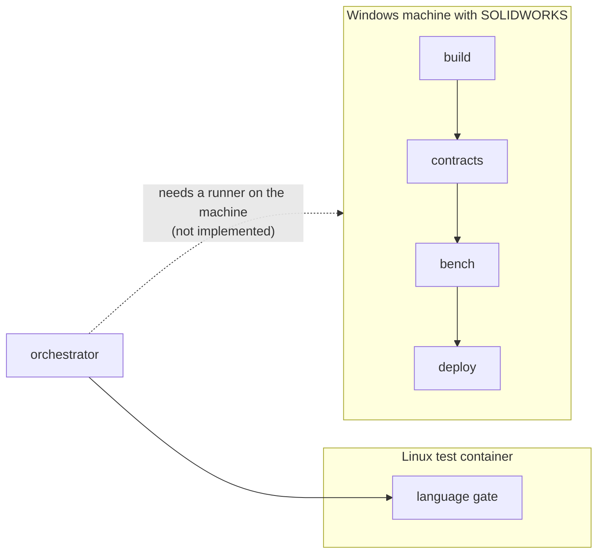
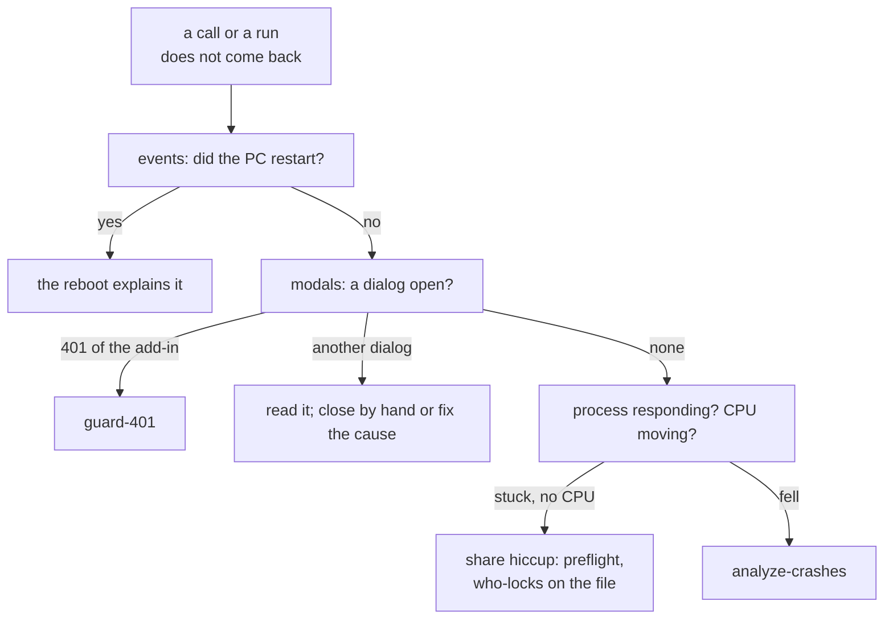

# Operations manual

Version 1.0.0 (08/11/2026). Changes to this manual and to the scripts of `Ops/` are
listed at the end, and every script carries its own version and changelog in its header.

This page is for an agent that works on this repository **without a person watching**
(an orchestrator such as DevAgentAi, or a Claude session on the machine), and for the
person who checks its work. Every procedure gives: prerequisites, the exact command, what
the output must say, the exit codes, and the errors already met with their cause and
remedy. The remedies are in [KNOWN-ERRORS.md](KNOWN-ERRORS.md) under the name in brackets,
for example [stale-shell-variable].

The map of the repository is [REPO-MAP.md](../REPO-MAP.md). The rules for AI agents in
general are in [AGENTS.md](../AGENTS.md).

## 1. What runs where

| step | needs | where it can run |
|---|---|---|
| language gate | `node`, `git` | anywhere, also a Linux test container |
| publishability check | PowerShell, `git` | Windows (it is a `.ps1`) |
| build (`build.ps1`) | Windows, MSBuild 2022, .NET Framework 4.8, the SOLIDWORKS interop | the Windows machine with SOLIDWORKS |
| contract suite | the build | Windows; without the interop the bridge checks say "not here" |
| bench | the build, a running SOLIDWORKS session, the weld profile library | the Windows machine with SOLIDWORKS, one run at a time |
| deploy | green bench and contracts on the same commit | the Windows machine whose MCP clients start the bridge |



The language gate is the only check an orchestrator can run in a Linux container. The
build, the contracts, the bench and the deploy need the Windows machine with SOLIDWORKS;
they run through the scripts of this folder, launched by an agent session on that machine.

**For an orchestrator with a Linux test container** the test command of this project is
the language gate, judged with the new files too (the detector reads `git ls-files`, and
before the tests a new file of the worker is not added to git yet; the repository may be
mounted read-only, so the temporary index gets its own object store):

```sh
G=/tmp/gate && mkdir -p "$G/obj" && cp "$(git rev-parse --git-path index)" "$G/index" && O="$(cd "$(git rev-parse --git-path objects)" && pwd)" && export GIT_INDEX_FILE="$G/index" GIT_OBJECT_DIRECTORY="$G/obj" GIT_ALTERNATE_OBJECT_DIRECTORIES="$O" && git ls-files -z --others --exclude-standard | xargs -0 -r git add -N -- && node Checks/language/detect-italian.js
```

Measured on such a container (2 CPU, 2048 MB, no network): exit 0 in 6.8 s on a clean tree,
exit 1 with a new file containing Italian. It does **not** prove the C# compiles: a change
of code is proven only by the steps of section 5 to 8 on the Windows machine.

## 2. Rules of autonomous work

What an agent does alone, and what it never does without the owner's yes in the chat.

| always | never without the owner |
|---|---|
| read [KNOWN-ERRORS.md](KNOWN-ERRORS.md) before guessing a cause | a deploy (section 9) |
| `preflight` before a build, a bench or a deploy | restarting SOLIDWORKS over documents that are not test pieces |
| one bench at a time, started detached, waited for once | a probe that WRITES on assembly objects little explored (one crashed SOLIDWORKS) |
| bump `VERSION.txt` and write `CHANGELOG.md` with every code change | touching the owner's real projects, or checking anything into the PDM |
| full bench and contracts green before a push that matters | changing a scheduled task, a system or security setting |
| look at the CI after every push | `setx` or any persistent environment variable |
| say "not tested, hypothesis" for what was not measured | `git push --no-verify`, rewriting published history |

And these, never at all:

- two benches at once, or a build of the library while a bench runs, or a COM probe while a
  bench runs: they share the one SOLIDWORKS session and the same binaries;
- the bench inside a PowerShell pipeline (`| Select-Object -First`, `| Tee-Object`) [bench-in-pipeline];
- the bench executable's own option to close leftovers: it starts a whole case group [close-leftovers-with-the-bench];
- the WMI class `Win32_Product`: reading it reconfigures every MSI package of the machine, and it once broke the start of SOLIDWORKS;
- a test against the production bin folder of the bridge, other than the start test of `smoke-bridge`.

Use only dedicated test pieces, recreated from scratch. Report what was done with the
numbers measured and the files written, and say which bridges keep running an old version.

## 3. The toolkit

All commands are scripts in `Ops/commands/`. Each runs in its own PowerShell process, so a
variable it sets (`OCE_NO_ATTACH`, `OCE_WELDMENT_PROFILES`) never stays behind in the caller's
shell [stale-shell-variable]. Two equivalent ways to call one:

```text
powershell -NoProfile -ExecutionPolicy Bypass -File Ops\ops.ps1 <command> [arguments]
powershell -NoProfile -ExecutionPolicy Bypass -File Ops\commands\<command>.ps1 [arguments]
```

`Ops\ops.ps1 help` lists them. A list argument is ONE string: `-Folders "a,b"`, `-Variants "x|y"`.

| command | what it does | changes the machine? | exit codes |
|---|---|---|---|
| `preflight` | OK / WARN / BLOCK lines about tools, SOLIDWORKS, bench, share, session, reboots | no | 0 ok, 1 warn, 2 block |
| `contracts` | build, contract suite (`OCE_NO_ATTACH=1`), language gate with new files | builds `bin/` | 0 green, 1 red, 2 build failed |
| `bench-run` | runs `Bench/bench.ps1` detached with a watchdog and a state file | drives SOLIDWORKS | of the last round, 6 stalled, 2 usage |
| `bench-status` | prints the state of a run; `-Wait` waits once until it is closed | no | 0 green, 1 red, 2 no state, 3 running, 4 stalled |
| `deploy` | gates, backup, copy, SHA-256, start test, automatic rollback; `-Rollback` | the target bin folder | 0 ok, 1 rolled back, 2 refused, 3 rollback failed |
| `smoke-bridge` | `initialize` + `tools/list` of an executable, without SOLIDWORKS | no | 0 ok, 1 failed, 2 no executable |
| `restart-solidworks` | ExitApp (or Stop-Process), start, wait until ready; add-in on/off | closes SOLIDWORKS | 0 ready, 1 not ready, 2 usage, 3 refused |
| `open-documents` | lists the open documents; `-CloseAllDiscarding` under an allowed folder | with the switch | 0, 2 not attachable, 3 refused |
| `close-leftovers` | closes never-saved documents and those of the test folders | with `-Close` | of CloseLeftovers.exe, 2 not built |
| `modals` | lists the dialogs of SOLIDWORKS, clicks nothing | no | 0 none, 1 some, 2 not running |
| `guard-401` | closes only the add-in dialogs of an expired token, for N minutes | closes those dialogs | 0, 2 configuration |
| `events` | reboots, blue screens, crashes and hangs from the event logs | no | 0 none, 1 some |
| `analyze-crashes` | extracts the SOLIDWORKS crash dumps and reads them with cdb | writes in the output folder | 0, 2 no cdb |
| `who-locks` | which local processes hold a file open (Restart Manager) | no | 0 none, 1 some, 2 error |
| `repo-map` | writes or checks the generated part of `REPO-MAP.md` | `-Write` writes the map | 0, 1 stale, 2 usage |

`-DryRun` exists on every command that changes something: it says what it would do and
touches nothing.

## 4. Setting up the machine (once)

Prerequisites: Windows 10 or later, SOLIDWORKS (the interop under
`C:\Program Files\SOLIDWORKS Corp\SOLIDWORKS\api\redist`), Visual Studio 2022 Build Tools
with MSBuild and .NET Framework 4.8, `git`, `node`, `gh` for the CI.

1. Copy `Ops/ops.config.example.psd1` to `Ops/ops.config.local.psd1` and fill in the values
   of the machine. That file is ignored by git: real paths never enter the repository.
2. Turn on the hooks: `powershell -NoProfile -ExecutionPolicy Bypass -File Checks\install-hooks.ps1`.
   It points `core.hooksPath` at `Checks/hooks`; once per clone.
3. Build the probes, among them CloseLeftovers:
   `powershell -NoProfile -ExecutionPolicy Bypass -File Checks\build-checks.ps1`.
4. Run `Ops\ops.ps1 preflight -For bench`. Expected: no BLOCK line.

## 5. Preflight

```text
powershell -NoProfile -ExecutionPolicy Bypass -File Ops\ops.ps1 preflight -For bench
```

`-For` is `build`, `contracts`, `bench` or `deploy`; it decides which problems block.
Read every WARN line: each names a trap of [KNOWN-ERRORS.md](KNOWN-ERRORS.md). Typical BLOCKs:
a bench already running, SOLIDWORKS not responding or with a dialog open, the weld profile
folder not answering within 20 s [share-hiccup], `OCE_NO_ATTACH` set in the shell
[stale-shell-variable], tracked files changed (for a deploy).

## 6. Build

```text
powershell -NoProfile -ExecutionPolicy Bypass -File build.ps1
```

Output: `bin/oce-solid-agent-mcp.exe`, `bin/catalog.json` regenerated from the library, and
`dist/Installer.exe`. Exit 0 = built; any other exit = read the first `error CS` line.
`-BridgeOnly` skips the installer. After a fast-forward of `main`, build before the
contracts: the bridge, the exported catalog and the installer carry `VERSION.txt`, and an
old `bin/` gives "wrong version" reds that are not regressions.

Never build while a bench runs [bench-and-build].

## 7. Contracts

```text
powershell -NoProfile -ExecutionPolicy Bypass -File Ops\ops.ps1 contracts
```

What it does: `build.ps1` (skip with `-SkipBuild`), build of `Tests/Oce.Solid.Agent.ContractTests.csproj`,
the suite with `OCE_NO_ATTACH=1` (pass `-Attach` only when you want the bridge checks to use
the SOLIDWORKS session), then the language gate with the new files included.

Expected output, last lines:

```text
[..] contracts exit 0
N checks, 0 failed, M not runnable here (K really done)
[..] language exit 0 (U untracked files judged too)
language gate: held (nothing left outside the signed exceptions).
```

Logs and `contracts-summary.json` go to the output folder. Exit 0 green, 1 red (the `NO`
lines name the checks), 2 build failed. Known reds that are not regressions:
leftover documents active in SOLIDWORKS make a confirmation contract time out
[leftover-documents]; a stale `bin/` gives version reds (build first).

## 8. Bench

Prerequisites: `preflight -For bench` without BLOCK; SOLIDWORKS restarted if it has been up
for a day or has made thousands of documents [solidworks-short-of-resources]; no other run.

Start it detached and come back once:

```text
powershell -NoProfile -ExecutionPolicy Bypass -File Ops\ops.ps1 bench-run -Detach
powershell -NoProfile -ExecutionPolicy Bypass -File Ops\ops.ps1 bench-status -Wait
```

`bench-run -Detach` prints the output file and its state file `<output>.state`, and returns.
A full run lasts 60 to 70 minutes. `bench-status -Wait` waits up to 55 minutes (below the
limit of a tool call) and exits 3 if the run is still going: call it again. Do not read the
run journal every few minutes [bench-watched].

Useful arguments of `bench-run` (they go to `Bench/bench.ps1` through `-Extra`):

| goal | command |
|---|---|
| one family while working | `bench-run -Detach -Extra "-Family features"` |
| single cases | `bench-run -Detach -Extra "-SkipCompilation -Case case_a,case_b"` |
| the same run 4 times, SOLIDWORKS fresh each time | `bench-run -Detach -Repeat 4 -RestartSolidWorks -ContinueIfRed` |
| an A/B of a variable | `bench-run -Detach -Repeat 4 -Variants "NAME=1|NAME=0" -RestartSolidWorks -ContinueIfRed` |
| templates copied locally (a share that hiccups) | `bench-run -Detach -LocalCopies` |

`Bench/bench.ps1` exit codes: 0 all green; 1 failed checks; 2 bench error (build failed,
SOLIDWORKS not attachable, a case that could not be measured); 3 documents open that are not
the bench's [leftover-documents]; 4 SOLIDWORKS went away mid-run (three documents not born in a
row) [share-hiccup]; 5 a call did not come back [call-does-not-come-back].
`bench-run` adds 6 for a round stopped by the watchdog.

After every round `bench-run` copies next to the output: the run journal (`_run.txt`), the
SOLIDWORKS journal (`_swjournal.swj`), the add-in log (`_addin.txt`); on exit 5, a minidump
of each live SOLIDWORKS (`_hung_<pid>.dmp`) before any restart.

**Green means**: exit 0, AND `Bench/report/last.json` has `batch`, `family` and `cases`
empty (a full run) with `failed` 0 and `errors` 0, AND the last line of `Bench/history.txt`
does not say "PARTIAL RUN" [partial-report]. Commit `Bench/report/last.json` of a full green
run in a commit of its own, after the code commit it measured.

## 9. Before a push

1. Make the hook's checks pass BEFORE the final full bench: a comment fixed after the run
   changes the commit the report names, and costs another full bench [check-before-the-bench].
   The hook runs: the CI-step check, the TODO probes, `Checks/zero-or-unknown.js --self-test`,
   the self-tests of the language tools, the publishability check. Run them on the branch.
2. The language gate judges every commit of the push, not only the last one.
3. Full bench green on the final commit, then the report commit.
4. `git push` (never `--no-verify`).
5. CI: `gh run list --limit 3`. On a branch other than `main` it runs only when started:
   `gh workflow run tests.yml --ref <branch>`, then `gh run watch <id> --exit-status`.
   A red CI is not left there [ci-not-looked-at].

## 10. Deploy (only when the owner asks)

Prerequisites: the owner asked for it in the chat; the commit is pushed; full bench green on
that commit (`Bench/report/last.json`); `DeployTarget` set in the local configuration.

```text
powershell -NoProfile -ExecutionPolicy Bypass -File Ops\ops.ps1 deploy -DryRun
powershell -NoProfile -ExecutionPolicy Bypass -File Ops\ops.ps1 deploy -Reason "<who asked, when, where>"
```

The gates, in order, each one refuses with exit 2 and touches nothing:

| gate | refuses when |
|---|---|
| G1 | a tracked file is changed (a deploy takes a commit) |
| G2 | `Bench/report/last.json` is partial, not green, or names a commit with other changes since (only the report may differ) |
| G3 | `contracts` (build included) is not green |
| G4 | the built executable does not carry the version of `VERSION.txt` |

Then: backup of the target into `<parent>/bin-backup-<date-time>`; copy file by file, a file
in use (a bridge started by an open MCP session) renamed to `<name>.old-<HHmmss>` first;
`*.jsonl` never copied [bin-log-overwritten]; SHA-256 of every file compared; start test of
the deployed executable with the expected version. If the hashes or the start test fail the
target is restored from the backup by itself (exit 1). Exit 3 = the rollback failed too: tell
the owner at once. A JSON record of every deploy goes to the output folder.

Say it in the report: **bridges already running keep the old version until their MCP
session restarts**; the deploy lists how many run from the target.

Rollback by hand: `deploy -Rollback <bin-backup-folder> -Reason "<why>"`.

## 11. SOLIDWORKS

| goal | command | note |
|---|---|---|
| list the open documents | `open-documents` | attaches to the session, changes nothing |
| close the test leftovers | `close-leftovers -Close` | never-saved documents and the test folders only; saves nothing |
| close everything, test pieces only | `open-documents -CloseAllDiscarding` | refuses if one saved document is outside `DocumentsAllowedRoot` |
| restart | `restart-solidworks` | refuses with documents open (exit 3) |
| restart a process that does not respond | `modals` first, then `restart-solidworks -Kill` | |
| restart without an add-in, then with it again | `restart-solidworks -AddIn off`, later `restart-solidworks -AddIn on` | SOLIDWORKS writes the add-in start value on exit [addin-stays-off] |

The bench restarts SOLIDWORKS by itself at the start of a full run (unless `-NoRestart`).

## 12. When something hangs or falls



First the reboot: `events` (look at "last boot" and the System events) [reboot-first]. Then
the dialogs: `modals`; an add-in message box with HTTP 401 is closed by `guard-401` while the
owner signs in again [addin-401-dialogs]. No dialog and no CPU: the network share hiccups
[share-hiccup]. A crash: `analyze-crashes -Since "<yyyy-MM-dd HH:mm>"`.

| goal | command |
|---|---|
| events since a time | `events -Since "2026-11-03 13:00"` |
| dialogs of SOLIDWORKS | `modals` |
| keep a run alive over 401 dialogs | `guard-401 -Detach -Minutes 90` (log in the output folder) |
| who holds a file | `who-locks -Path "<file>"` (none local = another machine holds it) |
| read the crash dumps | `analyze-crashes -Since "2026-11-03 00:00"` (needs `Cdb`) |
| start test of a bridge | `smoke-bridge -Exe bin\oce-solid-agent-mcp.exe -ExpectVersion <x.y.z>` |

## 13. The map

After adding, moving or removing a folder: describe it in `Ops/repo-map.folders.psd1`, then
`repo-map -Write` and `repo-map -Check` (exit 0). The check also fails on a path cited in
`REPO-MAP.md` that does not exist.

## Changes

- 1.0.0 (08/11/2026): first version of the manual and of the toolkit: 15 commands in
  `Ops/commands`, the shared helpers in `Ops/lib/Common.ps1`, the configuration example, the
  known errors, the repository map and its generator.
