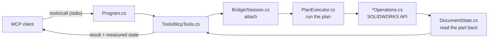
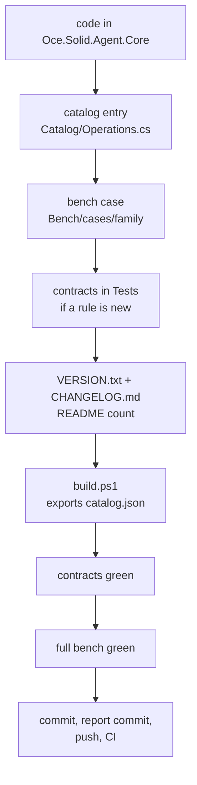
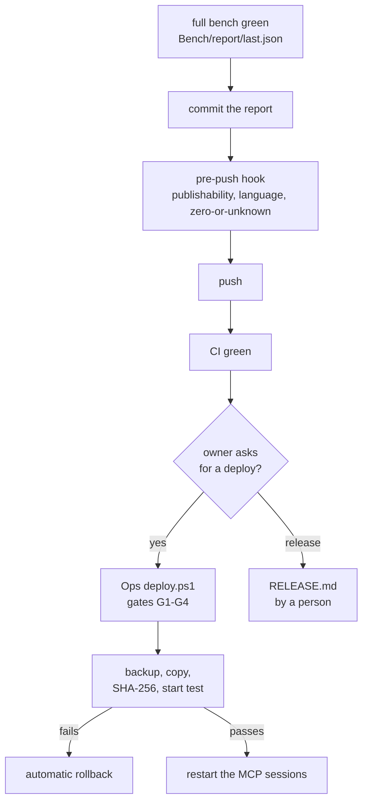

# Repository map

Where everything is, who reads it and who writes it, for an agent or a person who
arrives here without context. Read [AGENTS.md](AGENTS.md) first; the operations
(build, bench, contracts, deploy, diagnostics) are in [Ops/README.md](Ops/README.md).

**Two parts.** The block between the two `GENERATED` markers at the end is written by
a script, never by hand: folders, sub-folders, root files, counts. Everything above it
is written by hand. The descriptions of the folders live in
[Ops/repo-map.folders.psd1](Ops/repo-map.folders.psd1).

```text
powershell -NoProfile -ExecutionPolicy Bypass -File Ops\commands\repo-map.ps1 -Write    rewrite the generated block
powershell -NoProfile -ExecutionPolicy Bypass -File Ops\commands\repo-map.ps1 -Check    exit 1 if the map is stale
```

`-Check` fails on a new top-level folder without a description, on a new sub-folder of
an expanded folder, on a folder or file that no longer exists, and on any path cited
in this page (in `code` or in a link) that does not exist. Run it after adding or
moving a folder. Counts are not compared: a new case file does not make the map stale.

## Entry points

| what | where | notes |
|---|---|---|
| the bridge executable | `Program.cs` | stdio MCP loop: `initialize`, `tools/list`, `tools/call` |
| the tools the model sees | `Tools/McpTools.cs` | `inspect_part`, `build`, `measure`, `document`, `undo`, ... |
| attaching to SOLIDWORKS | `Bridge/Session.cs` | `GetActiveObject`; `OCE_NO_ATTACH` starts without attaching |
| the MCP protocol pieces | `Mcp/Protocol.cs`, `Mcp/Elicitation.cs`, `Mcp/Progress.cs` | |
| the operations | `Oce.Solid.Agent.Core/` | `SwOperations.cs` and one `*Operations.cs` per family |
| running a plan | `Oce.Solid.Agent.Core/PlanExecutor.cs` | steps in order, refusal before the first step |
| reading the part back | `Oce.Solid.Agent.Core/DocumentState.cs` | the state returned after every change |
| the catalog | `Oce.Solid.Agent.Core/Catalog/Operations.cs` | exported to `Tools/catalog.json` by `Oce.Solid.Agent.Catalog/Program.cs` |
| the bench | `Bench/bench.ps1`, `Bench/Program.cs` | drives a real SOLIDWORKS session |
| the contract suite | `Tests/Program.cs` | no SOLIDWORKS needed; what the CI runs |
| the probes and gates | `Checks/` | probes drive SOLIDWORKS; `Checks/hooks/pre-push`; `Checks/language/detect-italian.js` |
| the installer | `Installer/Program.cs`, `Installer/Verify.cs` | `Installer.exe --verify` |
| the skill for models | `Skills/solidworks-bridge/SKILL.md` | |
| the operations toolkit | `Ops/ops.ps1` | one command per script in `Ops/commands/` |

## Where do I find

| question | path |
|---|---|
| where is an operation implemented? | `Oce.Solid.Agent.Core/` (`SwOperations.cs`, the `*Operations.cs` of its family) |
| where is it described to the model (arguments, limits, refusals)? | `Oce.Solid.Agent.Core/Catalog/Operations.cs` |
| which operations are served? | `Tools/catalog.json` (exported, never edited; how: `Tools/update.md`) |
| where is the test case of an operation? | `Bench/cases/`, one folder per family (rules: `Bench/README.md`, section "The cases") |
| cases written but not yet running? | `Bench/pending-cases/` |
| where does the bench report go? | `Bench/report/last.json` (tracked: the proof of the last full run); every run also in `Bench/report/`, one line per run in `Bench/history.txt` (not tracked) |
| how far is a running bench? | `Bench/in-progress.txt` (not tracked); a detached run: `Ops/commands/bench-status.ps1` |
| where are the contracts? | `Tests/` (`Tests/Program.cs` lists them; one file per rule) |
| where do I bump the version? | `VERSION.txt` and an entry in `CHANGELOG.md`, with every code change |
| where are the pre-push hooks? | `Checks/hooks/pre-push`, installed by `Checks/install-hooks.ps1` |
| what may not be published? | `Checks/check-publishability.ps1` (user name, private addresses, network drives, session paths) |
| the language gate and its exceptions? | `Checks/language/detect-italian.js`, `Checks/language/exceptions.json` (signed by the owner only) |
| the CI? | `.github/workflows/tests.yml`, steps in `.github/steps/` |
| which environment variables does the bridge read? | `README.md`, section "Environment variables" (a contract checks the list) |
| how does a call that never comes back end? | `Shared/Leash.cs` (the bench exits 5: "THE CALL DOES NOT COME BACK") |
| closing the test documents left open? | `Checks/CloseLeftovers/Program.cs`, through `Ops/commands/close-leftovers.ps1` |
| building the probes? | `Checks/build-checks.ps1` |
| the release? | `RELEASE.md`, `Checks/prepare-release.ps1`, `Checks/release-candidate.ps1` |
| the deploy to the machine's bin folder? | `Ops/commands/deploy.ps1` (gates inside; rules in `Ops/README.md`) |
| names of SOLIDWORKS features in other languages? | `Oce.Solid.Agent.Core/Localization/solidworks-names.json` |
| what is known about the SOLIDWORKS API? | `Oce.Solid.Agent.Core/Api/ApiCatalog.cs`, `Tools/api_knowledge.json` |
| a trap that already cost a run? | `Ops/KNOWN-ERRORS.md` |
| the values of this machine? | `Ops/ops.config.local.psd1` (not tracked; the keys: `Ops/ops.config.example.psd1`) |

## Flow 1: a tool call, from the model to SOLIDWORKS and back



The client calls a tool through `Program.cs`; `Tools/McpTools.cs` turns it into a plan;
`Bridge/Session.cs` holds the attached SOLIDWORKS session; `PlanExecutor.cs` runs the steps
through the operations; `DocumentState.cs` reads the part again, and the answer carries
what was measured, not what the API returned.

## Flow 2: adding an operation



Write the code next to its family, describe it in the catalog (it is exported only when
it has been measured), add the bench case that measures it, and a contract when the
change brings a rule that can be checked without SOLIDWORKS. Bump the version, write the
changelog entry and the operations count of the README. Then build, contracts, full bench,
commit the report, push, and look at the CI.

## Flow 3: release and deploy



A deploy happens only when the owner asks for it. The script refuses unless the full
bench is green on the same commit and the contracts are green; it backs the target up,
copies (renaming files in use), compares the hashes, runs a start test, and rolls back by
itself when one of them fails. Bridges already running keep the old version until their
MCP session restarts. Tags and GitHub releases are made by a person (`RELEASE.md`).

## Operations and documents for agents

- [AGENTS.md](AGENTS.md): what an agent may do, and where to start.
- [Ops/README.md](Ops/README.md): every procedure, with prerequisites, commands, expected output and exit codes.
- [Ops/KNOWN-ERRORS.md](Ops/KNOWN-ERRORS.md): symptoms, causes and remedies already paid for.
- [INSTALL-FOR-AI.md](INSTALL-FOR-AI.md): installing the bridge for someone.
- [Bench/README.md](Bench/README.md): the bench in detail, and the rules of the cases.
- [Tools/update.md](Tools/update.md): regenerating the catalog.

## Generated part

<!-- GENERATED BY Ops/commands/repo-map.ps1: BEGIN (do not edit by hand) -->

Files in the map: 925 (tracked, plus new files git does not ignore). Counts are those of the last -Write.

### Folders

| folder | files | what it is | read by | written by |
|---|---|---|---|---|
| `.github/` | 10 | CI: tests.yml (language gate, build, contract suite, what could not run), language-gate.yml, installer-smoke.yml, and their steps in .github/steps | GitHub Actions (windows-latest); Checks/check-workflow.ps1 in the pre-push hook | by hand |
| `Bench/` | 537 | the bench: the C# runner that drives a real SOLIDWORKS session, the cases (Bench/cases/<family>/*.json), the tasks, the report | Bench/bench.ps1, Ops/commands/bench-run.ps1, the contract suite and the CI (Bench/report/last.json) | cases by hand with each operation; Bench/report/last.json by bench.ps1 (committed after a full green run) |
| `Bridge/` | 7 | the SOLIDWORKS side of the bridge: attaching to the session (Session.cs, OCE_NO_ATTACH), documents, plans kept in memory, shape | Program.cs, Tools/McpTools.cs | code changes |
| `Checks/` | 90 | probes that drive SOLIDWORKS (one folder each), the release scripts, the publishability and language gates (Checks/language), the git hooks (Checks/hooks) | the pre-push hook, the CI, the maintainer; Checks/CloseLeftovers is used by the bench and by Ops | by hand |
| `Installer/` | 10 | Installer.exe: window, silent mode, --verify, uninstall; it carries the bridge inside | build.ps1 (embeds bin into Installer/Payload), the people who install | code changes |
| `Mcp/` | 4 | pieces of the MCP protocol: protocol helpers, elicitation, resources, progress notifications | Program.cs | code changes |
| `Oce.Solid.Agent.Catalog/` | 2 | the program that exports Tools/catalog.json from the catalog in the library (Tools/update.md) | build.ps1 | code changes |
| `Oce.Solid.Agent.Core/` | 112 | the library of operations: SwOperations.cs and the *Operations.cs files, PlanExecutor.cs, DocumentState.cs, and the catalog the tools are exported from (Catalog/Operations.cs) | the bridge, the bench, the catalog exporter, the contract suite | code changes |
| `Ops/` | 21 | the operations toolkit for agents and people: preflight, detached bench, contracts, deploy with gates, SOLIDWORKS restart, diagnostics; the manual (Ops/README.md) and the known errors (Ops/KNOWN-ERRORS.md) | agents (DevAgentAi, a Claude session), the maintainer | by hand; Ops/out and the local configuration are not tracked |
| `Shared/` | 5 | code shared by bridge, bench and tests: Leash.cs (a call that does not come back), McpClient.cs, SolidWorksSentinel.cs, PreparationFailed.cs | the bridge, the bench, the contract suite | code changes |
| `Skills/` | 5 | the skill that teaches a model to drive the bridge (Skills/solidworks-bridge/SKILL.md and its references) | Claude clients that load the skill | by hand, with a version in SKILL.md |
| `Tests/` | 98 | the contract suite: needs no SOLIDWORKS (the checks that need it say "not here"), it is what the CI runs | Ops/commands/contracts.ps1, the CI | code changes, one contract per rule |
| `Tools/` | 6 | the MCP tool definitions (McpTools.cs), the catalog reader (Catalog.cs), the exported catalog.json, api_knowledge.json, QuestionRegistry.cs | Program.cs; catalog.json is served next to the executable | catalog.json by Oce.Solid.Agent.Catalog.exe only, never by hand |

### Sub-folders

- `.github/`: `steps/` (6), `workflows/` (3)
- `Bench/`: `cases/` (476), `data/` (2), `pending-cases/` (2), `report/` (1), `tasks/` (27)
- `Bench/cases/`: `assemblies/` (28), `axis/` (2), `bodies/` (15), `bridge/` (107), `chamfer/` (4), `check/` (7), `dimensions/` (8), `document_properties/` (13), `drawing/` (77), `export/` (15), `extrusions/` (12), `features/` (39), `frames/` (1), `limits/` (8), `measurement/` (13), `mirror/` (2), `pairs/` (8), `patterns/` (15), `plane/` (7), `reanchor/` (3), `regression/` (19), `removal/` (5), `revolve/` (5), `sentence/` (2), `sheet_metal/` (13), `slot/` (18), `text/` (6), `views/` (6), `weldments/` (17)
- `Checks/`: `AssemblyUndo/` (1), `Bracket/` (1), `BrokenBody/` (1), `ChangeByHand/` (1), `CloseLeftovers/` (1), `D9Defects/` (2), `DetailView/` (1), `DimensionApis/` (1), `DimXpert/` (1), `DrawingDimensions/` (1), `DrivenSketch/` (1), `EdgeFlange/` (1), `ExtrusionType/` (1), `FaceFillet/` (1), `FacesBeyondSixty/` (1), `Fill/` (1), `FollowTheEdge/` (1), `FramingTest/` (1), `GearTest/` (1), `Gusset/` (1), `HoleOrFillet/` (1), `hooks/` (1), `language/` (18), `Modal/` (1), `NewPart/` (1), `Option/` (1), `Orphan/` (1), `OutlineTest/` (1), `PdfText/` (1), `PositionsTest/` (1), `RedTree/` (1), `Rib/` (1), `RibWithdraw/` (1), `RoleCoverage/` (1), `SectionView/` (1), `Select/` (1), `SheetMetal/` (1), `SketchOnSheet/` (1), `SolidWorksLanguage/` (1), `Thickness/` (1), `Undo/` (1), `UndoGaps/` (1), `UndoSplit/` (1), `ViewTest/` (1)
- `Oce.Solid.Agent.Core/`: `Api/` (1), `Catalog/` (4), `Localization/` (3), `Properties/` (1)
- `Ops/`: `commands/` (15), `lib/` (1)
- `Skills/`: `solidworks-bridge/` (4)
- `Tests/`: `data/` (5)

### Root files

| file | what it is | read by | written by |
|---|---|---|---|
| `.gitattributes` | line endings and binary types for git | git | by hand |
| `.gitignore` | what git never tracks: build outputs, bench outputs, internal notes, the local Ops configuration | git, Checks/check-publishability.ps1 | by hand, every line with its reason |
| `AGENTS.md` | the first page for an AI agent: install, change the repository, work autonomously | AI agents; an orchestrator may inject it into its prompts | by hand |
| `App.config` | configuration of the bridge executable (.NET Framework 4.8) | the bridge at start | by hand |
| `build.ps1` | builds the bridge into bin/, the catalog, and dist/Installer.exe | people, Ops/commands/contracts.ps1, Ops/commands/deploy.ps1 | by hand |
| `CHANGELOG.md` | one entry per version; every code change bumps VERSION.txt and adds an entry | people, the release, the contract suite | with every change |
| `CONTRIBUTING.md` | what the project accepts: issues yes, pull requests not yet; declared is not measured | contributors, agents | by hand |
| `INSTALL-FOR-AI.md` | the installation procedure an AI agent follows step by step, with exit codes | AI agents asked to install | by hand |
| `LICENSE` | Apache License 2.0 | everyone | never changed |
| `NOTICE` | copyright and trademark notices | everyone, the installer | by hand |
| `Oce.Solid.Agent.csproj` | the project of the bridge executable | build.ps1, MSBuild, the CI | code changes |
| `Program.cs` | the bridge: the stdio MCP server loop (initialize, tools/list, tools/call) | MSBuild | code changes |
| `QUICKSTART.md` | installation by hand, for a person | people | by hand |
| `README.md` | what the bridge is, the tools, the operations count, the environment variables, how it is measured, how to build | people; contracts read its numbers | by hand; counts changed where declared |
| `RELEASE.md` | the release rite, done by a person (tag and GitHub release) | the maintainer | by hand |
| `REPO-MAP.md` | this map: folders, entry points, where to find what, main flows | agents and people | generated part by Ops/commands/repo-map.ps1, the rest by hand |
| `SECURITY.md` | how to report a vulnerability privately | people | by hand |
| `VERSION.txt` | the version of the bridge, one line | build.ps1, the bridge (serverInfo), the installer, the contracts, Ops deploy | with every code change |

### Files by extension

`.json` 496, `.cs` 289, `.ps1` 42, `.md` 39, `.js` 32, `.csproj` 6, `(none)` 4, `.tsv` 4, `.yml` 3, `.psd1` 2, `.png` 2, `.txt` 2

<!-- GENERATED BY Ops/commands/repo-map.ps1: END -->
